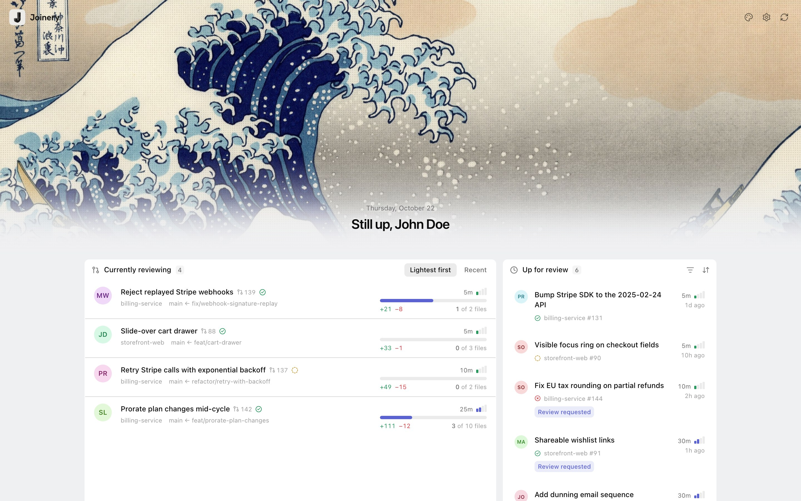
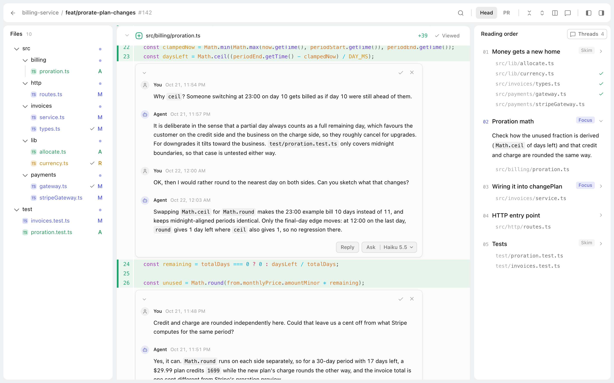
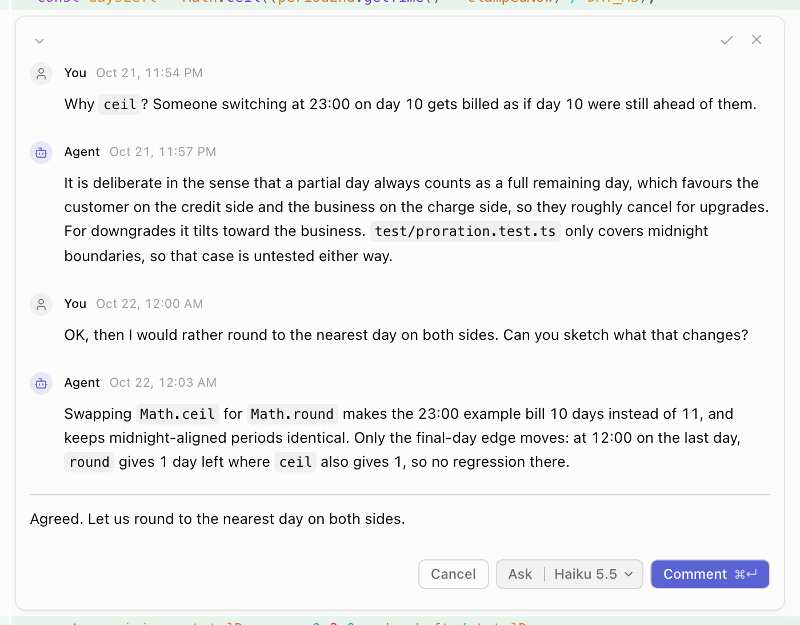
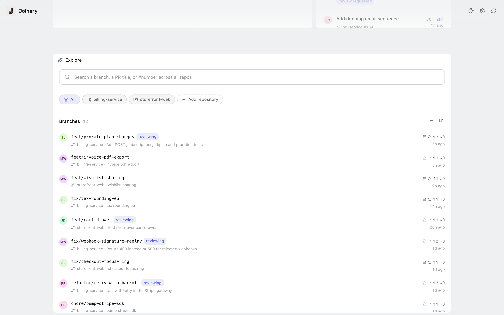

<p align="center">
  <picture>
    <source media="(prefers-color-scheme: dark)" srcset="apps/web/public/joinery-wordmark-squircle-dark.svg" />
    
  </picture>
</p>

<p align="center"><b>A local-first, agent-native code review app.</b></p>

<p align="center">
  <a href="#install">Install</a> ·
  <a href="#development">Development</a>
</p>

<p align="center">
  <a href="LICENSE"></a>
  
</p>

https://github.com/user-attachments/assets/9e65d5d0-4fc3-4bb8-81ea-a9c59a61e001

Joinery renders diffs fast, walks you through a change with a generated reading
order, and keeps comment threads that Claude Code can answer asynchronously.

- **Local-first.** Everything runs on your machine. State lives in SQLite under
  `data/`, and comments are never posted to GitHub.
- **Agent-native threads.** Ask a question on any line and Claude Code replies
  in the thread, while you keep reading.
- **Generated reading order.** The change is split into ordered steps, each
  marked Focus or Skim, so you know where to spend your attention.
- **Fast diffs.** Per-file viewed checks, and a revision picker for the working
  tree, committed head, and PR head.
- **One dashboard.** Homebase lists every branch and open PR across your
  registered repos and shows what is waiting on you.

## Tour

### Homebase

One row per branch across your registered repos, covering both local branches
and open PRs. Each row shows size, viewed progress, and what is waiting on you.

<p align="center">
  <picture>
    <source media="(prefers-color-scheme: dark)" srcset="docs/media/homebase-dark.jpg" />
    
  </picture>
</p>

### Review page

Three panes: the changed files, the diffs with inline threads, and the reading
order. Mark files as viewed as you go.

<p align="center">
  <picture>
    <source media="(prefers-color-scheme: dark)" srcset="docs/media/review-dark.png" />
    
  </picture>
</p>

### Agent threads

Comment on a line, then ask Claude Code to answer. Replies land in the same
thread, and you can reply back or resolve it.

<p align="center">
  <picture>
    <source media="(prefers-color-scheme: dark)" srcset="docs/media/thread-dark.png" />
    
  </picture>
</p>

### Explore

Search every branch and PR across your repos.

<p align="center">
  <picture>
    <source media="(prefers-color-scheme: dark)" srcset="docs/media/explore-dark.png" />
    
  </picture>
</p>

## Install

Joinery runs on macOS (Apple Silicon) and Linux (x64, arm64). You'll need `git`, the GitHub CLI
(`gh auth login`), and Claude Code (logged in) on your PATH.

```sh
curl -fsSL https://raw.githubusercontent.com/szhabolcs/joinery/main/scripts/install.sh | sh
```

This installs to `~/.joinery`, links `joinery` into `~/.local/bin`, and starts
the server as a background service (a LaunchAgent on macOS, a systemd user
unit on Linux).

The server listens on `127.0.0.1:7317`. If that port is taken, the installer
picks a free one; to choose it yourself, pass `--port`:

```sh
curl -fsSL https://raw.githubusercontent.com/szhabolcs/joinery/main/scripts/install.sh | sh -s -- --port 8123
```

The port is saved to `~/.joinery/data/.port`, and the server and CLI both read it.

```sh
joinery open      # open the web UI
joinery update    # update to the latest release and restart
joinery permissions  # grant Full Disk Access so macOS stops asking per folder
```

To uninstall:

```sh
joinery service uninstall
rm -rf ~/.joinery ~/.local/bin/joinery
```

Your data lives in `~/.joinery/data`, so keep it if you plan to reinstall.

## Development

```sh
bun install
bun run dev      # server + web
bun run check    # typecheck + tests
```

## Releasing

Bump `version` in the root `package.json`, then tag and push. GitHub Actions
builds the tarball and publishes the release.

```sh
git tag vX.Y.Z && git push --tags
```
